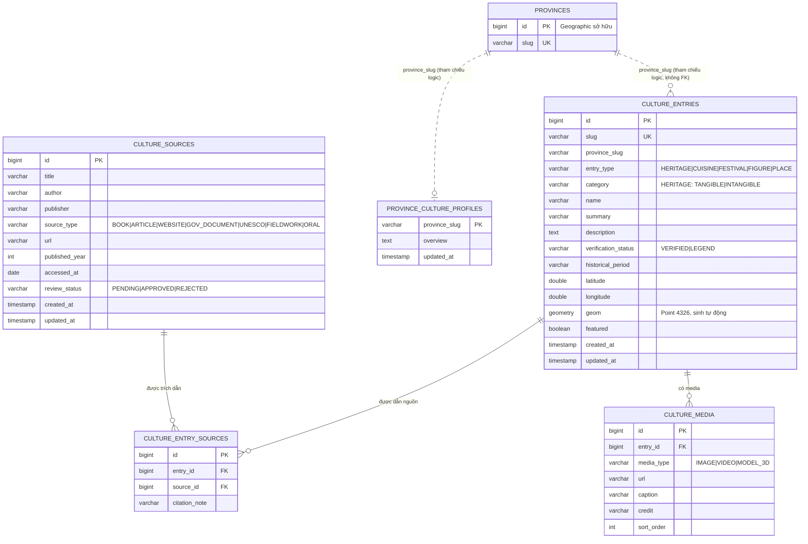

# Cultural API v1.0.0

Trạng thái: ĐỀ XUẤT, chờ Người 3 (Knowledge) và Người 4 (Assistant) review.
Owner: Người 2 – Cultural Knowledge Platform. Consumer: Người 4 (Cultural Tool), Người 3 (Source Metadata), Frontend (Province Drawer).

## 1. Phạm vi và quyền sở hữu

- Cultural sở hữu nội dung văn hóa (di sản, ẩm thực, lễ hội, nhân vật, địa điểm), nguồn tham khảo và media.
- Province thuộc Geographic. Cultural chỉ lưu `provinceSlug` theo `docs/api/provinces-v1.json`,
  không tạo bảng Province và không tạo khóa ngoại sang bảng `provinces`.
- Cultural kiểm tra địa phương qua public interface `GeographicService.detail()` / `identify()`,
  không truy cập repository hay bảng của Geographic.
- Bảng cũ `cultural_sites` và `/api/v1/cultural-sites` giữ nguyên cho bản đồ; không thuộc contract này.

## 2. ERD



Ràng buộc DB chính: `(entry_id, source_id)` duy nhất; xóa entry kéo theo xóa liên kết nguồn và media;
tọa độ phải có đủ cặp; PLACE bắt buộc có tọa độ; HERITAGE bắt buộc có category TANGIBLE hoặc INTANGIBLE.
Migration: `V6__create_culture_schema.sql`, `V7__seed_culture_ha_noi.sql`.

## 3. Phân loại

| Trường | Giá trị | Ý nghĩa |
|---|---|---|
| type | HERITAGE, CUISINE, FESTIVAL, FIGURE, PLACE | Loại nội dung |
| category | HERITAGE: TANGIBLE / INTANGIBLE; loại khác: tự do hoặc null | Phân loại con |
| verificationStatus | VERIFIED | Dữ kiện được xác nhận bởi ít nhất một nguồn văn bản đã duyệt |
| | LEGEND | Truyền thuyết, dân gian; nguồn chỉ ghi nhận câu chuyện, không xác nhận sự kiện lịch sử |
| source.sourceType | BOOK, ARTICLE, WEBSITE, GOV_DOCUMENT, UNESCO, FIELDWORK, ORAL | Loại nguồn |
| source.reviewStatus | PENDING, APPROVED, REJECTED | API công khai chỉ trả APPROVED |

Consumer (AI) không được trình bày nội dung LEGEND như sự thật lịch sử.

## 4. API công khai (chỉ đọc, không cần token)

| Method | Endpoint | 200 data | Lỗi |
|---|---|---|---|
| GET | /api/v1/cultures/provinces/{slug} | ProvinceOverview | 404 tỉnh không tồn tại |
| GET | /api/v1/cultures/provinces/{slug}/heritages | EntrySummary[] | 404 |
| GET | /api/v1/cultures/provinces/{slug}/cuisines | EntrySummary[] | 404 |
| GET | /api/v1/cultures/provinces/{slug}/festivals | EntrySummary[] | 404 |
| GET | /api/v1/cultures/provinces/{slug}/figures | EntrySummary[] | 404 |
| GET | /api/v1/cultures/provinces/{slug}/places | EntrySummary[] | 404 |
| GET | /api/v1/cultures/heritages/{id} | EntryDetail | 404 nếu không phải HERITAGE; 400 nếu id không phải số |
| GET | /api/v1/cultures/entries/{id} | EntryDetail | 404; 400 |

- Tỉnh tồn tại nhưng chưa có nội dung: 200 với `data: []` (khác 404).
- Danh sách sắp xếp featured trước, sau đó theo name. Không phân trang trong MVP.
- Thành công dùng envelope `ApiResponse<T>` hiện có.

## 5. Schema dữ liệu trả về

EntrySummary:
```json
{"id":5,"slug":"thanh-giong","provinceSlug":"ha-noi","type":"FIGURE","category":null,
 "name":"Thánh Gióng","summary":"Nhân vật truyền thuyết thời Hùng Vương",
 "verificationStatus":"LEGEND","coordinate":null,"thumbnailUrl":null,"sourceCount":1}
```

EntryDetail = các trường của EntrySummary (trừ thumbnailUrl, sourceCount) + `description`,
`historicalPeriod`, `sources: Source[]`, `media: Media[]`.

Source (contract Source Metadata cho Người 3, Người 4):
```json
{"id":1,"title":"Central Sector of the Imperial Citadel of Thang Long - Hanoi","author":null,
 "publisher":"UNESCO World Heritage Centre","sourceType":"UNESCO",
 "url":"https://whc.unesco.org/en/list/1328","publishedYear":2010,
 "reviewStatus":"APPROVED","citationNote":"Mục mô tả di sản"}
```

Media: `{"id":1,"mediaType":"IMAGE","url":"...","caption":"...","credit":"..."}`

ProvinceOverview:
```json
{"province":{"id":24,"slug":"ha-noi","name":"Hà Nội","adminUnit":"Thành phố Hà Nội"},
 "overview":"Thăng Long – Hà Nội là kinh đô ...",
 "counts":{"HERITAGE":3,"CUISINE":1,"FESTIVAL":1,"FIGURE":2,"PLACE":1},
 "highlights":[]}
```
`counts` luôn có đủ 5 khóa. `coordinate` là `{"latitude":..,"longitude":..}` hoặc null.

## 6. API quản trị (ADMIN, RESEARCHER)

| Method | Endpoint | Thành công | Lỗi |
|---|---|---|---|
| POST | /api/v1/admin/cultures/entries | 201 EntryDetail | 400, 409 trùng slug |
| PUT | /api/v1/admin/cultures/entries/{id} | 200 EntryDetail | 400, 404, 409 |
| DELETE | /api/v1/admin/cultures/entries/{id} | 204 | 404 |
| POST | /api/v1/admin/cultures/sources | 201 Source (reviewStatus=PENDING) | 400 |
| PATCH | /api/v1/admin/cultures/sources/{id}/review | 200 Source | 400, 404 |

Không có quyền: 403. Phân quyền dùng vai trò `ROLE_ADMIN`, `ROLE_RESEARCHER`; cần JWT filter của module Auth
để gọi thật (chưa có trong MVP hiện tại).

Request tạo/sửa entry:
```json
{"slug":"ho-hoan-kiem","provinceSlug":"ha-noi","type":"PLACE","category":null,
 "name":"Hồ Hoàn Kiếm","summary":"...","description":"...","verificationStatus":"VERIFIED",
 "historicalPeriod":null,"latitude":21.0287,"longitude":105.8524,"featured":true,
 "sources":[{"sourceId":3,"citationNote":"Mục ..."}],
 "media":[{"mediaType":"IMAGE","url":"https://...","caption":"...","credit":"..."}]}
```

Luật dữ liệu (vi phạm trả 400, mọi lỗi nằm trong `details`):

| Luật | Thông báo |
|---|---|
| Có ít nhất 1 nguồn | sources: Nội dung phải có ít nhất 1 nguồn tham khảo |
| Nguồn phải tồn tại, không trùng | Nguồn không tồn tại: id=...; Một nguồn bị gắn trùng nhiều lần |
| Có ít nhất 1 nguồn APPROVED | Cần ít nhất 1 nguồn đã được duyệt (APPROVED) |
| VERIFIED không chỉ dựa vào ORAL | VERIFIED cần ít nhất 1 nguồn văn bản đã duyệt... |
| provinceSlug có trong Geographic | provinceSlug không tồn tại trong Geographic: ... |
| Tọa độ nằm trong đúng tỉnh (Geographic identify) | Sai địa phương: tọa độ thuộc X, không thuộc Y |
| Tọa độ trong vùng dữ liệu | Tọa độ nằm ngoài vùng dữ liệu địa phương |
| PLACE có tọa độ; lat/lng đi theo cặp | PLACE bắt buộc có tọa độ; latitude và longitude phải cùng có... |
| HERITAGE có category hợp lệ | HERITAGE phải có category là TANGIBLE hoặc INTANGIBLE |
| Định dạng slug, khoảng tọa độ, enum | Theo từng trường |

## 7. Lỗi

Dùng `ErrorResponse` hiện có: `status`, `error`, `message`, `path`, `timestamp`, `details` (array hoặc null).

| HTTP | error | Trường hợp |
|---|---|---|
| 400 | Validation Error / Bad Request | Dữ liệu sai định dạng hoặc vi phạm luật ở mục 6; path id không phải số |
| 403 | — | Không có vai trò ADMIN/RESEARCHER (API quản trị) |
| 404 | Not Found | Tỉnh, entry hoặc source không tồn tại |
| 409 | Conflict | Trùng slug |
| 500 | Internal Server Error | Lỗi hệ thống; không lộ SQL/stack trace |

## 8. Migration và phiên bản

- Cultural dùng Flyway V6, V7. Migration mới của các module bắt đầu từ V8, báo nhóm trước khi tạo.
- Thêm trường optional được phép trong v1.x. Đổi tên/xóa trường, đổi ý nghĩa enum hoặc slug là breaking change:
  phải báo Người 3, Người 4 và chờ xác nhận.