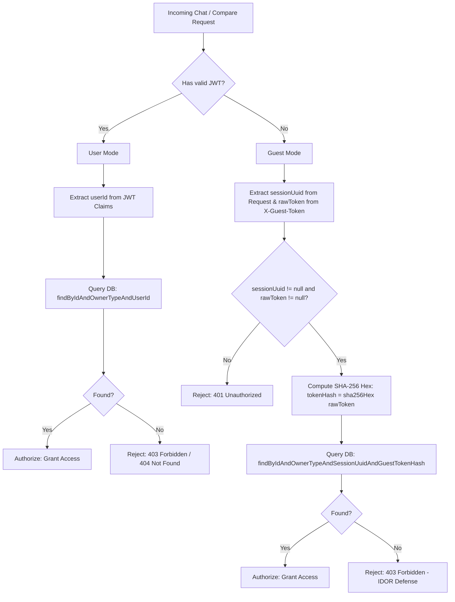
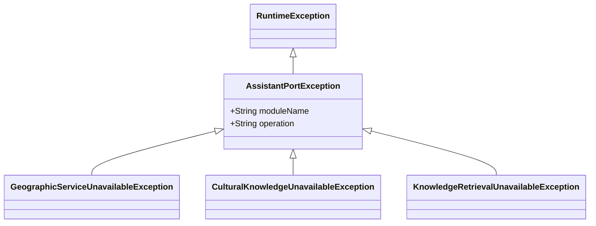
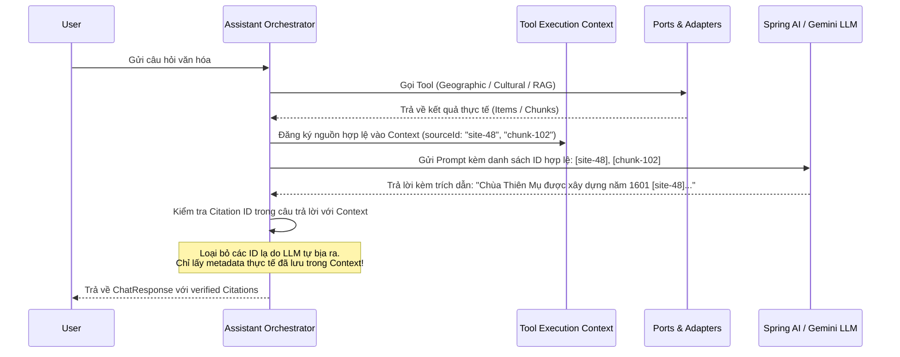

# TASK 4.2 — TECHNICAL DESIGN DOCUMENT v1.1
## Assistant DTOs & Application Ports Specification

> **Tài liệu**: Technical Design Specification cho Task 4.2  
> **Phiên bản**: v1.1 (Cập nhật từ v1.0 theo Review Feedback)  
> **Tác giả**: Member 4 (AI Orchestration & Assistant UX)  
> **Trạng thái**: Chờ phê duyệt (Giai đoạn Audit & Technical Design - Tuyệt đối không chỉnh sửa source code hoặc migration)  

---

## 1. Audit Contract thực tế của các Module trong Monolith

Đối chiếu trực tiếp mã nguồn thực tế tại `backend/src/main/java/com/culturalatlas/`:

### 1.1. Member 1 — Geographic Intelligence (`com.culturalatlas.geography`)
- **Entities & DTOs**:
  - `Province.java`: Entity JPA ánh xạ bảng `provinces`, chứa `id`, `slug`, `name`, `adminUnit`, `datasetVersion`, `boundary` (`MultiPolygon`, SRID 4326).
  - `ProvinceDto.java`: Record `(Long id, String slug, String name, String adminUnit)`.
  - `IdentifyProvinceRequest.java`: Record `(Double latitude, Double longitude)`.
- **Public Service (`GeographicService.java`)**:
  - `ProvinceDto detail(String slug)`: Tìm kiếm tỉnh theo slug. Nếu không tìm thấy, ném ngoại lệ `ProvinceNotFoundException`.
  - `ProvinceDto identify(IdentifyProvinceRequest request)`: Điểm trong vùng (Point-in-Polygon). Trả về `ProvinceDto` nếu tọa độ nằm trong biên giới; trả về `null` nếu ngoài phạm vi 63 tỉnh/thành.
  - `List<ProvinceDto> list()`: Trả về danh sách 63 tỉnh/thành.
- **Ranh giới tích hợp**:
  - `GeographicPort` của Assistant gọi trực tiếp `GeographicService` qua `GeographicAdapter`.
  - Không truy cập trực tiếp `ProvinceRepository`.

### 1.2. Member 2 — Cultural Knowledge Platform (`com.culturalatlas.heritage` & `com.culturalatlas.culture`)
- **Thực trạng**:
  - Gói `com.culturalatlas.culture`: Hiện chỉ có `package-info.java`.
  - Gói `com.culturalatlas.heritage`:
    - Entity `CulturalSite.java`: Di sản văn hóa vật thể (di tích lịch sử, kiến trúc nghệ thuật, danh lam thắng cảnh).
    - DTO `CulturalSiteDto.java`: Chứa `id`, `name`, `slug`, `category`, `categoryLabel`, `province`, `lat`, `lng`, `description`, `unescoYear`, `historicalPeriod`, `thumbnailUrl`, `color`, `featured`.
    - Service `CulturalSiteService.java`:
      - `List<CulturalSiteDto> getAllSites(String category)`
      - `Optional<CulturalSiteDto> getSiteBySlug(String slug)`
      - `Optional<CulturalSiteDto> getSiteById(Long id)`
    - Repository `CulturalSiteRepository.java`: Có sẵn method `findByProvinceIgnoreCase(String province)`.
- **Ranh giới tích hợp & Khoảng trống**:
  - **Quy tắc đóng gói (Encapsulation)**: `CulturalKnowledgeAdapter` **chỉ được gọi qua `CulturalSiteService`**, tuyệt đối **không được inject hoặc gọi trực tiếp `CulturalSiteRepository`**.
  - **Khoảng trống cần Member 2 bổ sung**: `CulturalSiteService` hiện chưa expose public method tìm di sản theo tỉnh. Assistant Module ghi nhận yêu cầu Member 2 bổ sung:
    ```java
    public List<CulturalSiteDto> getSitesByProvince(String province);
    ```
  - **Giới hạn phạm vi MVP**: Chỉ hỗ trợ `CulturalSite` (di sản vật thể). Thiết kế không giả định hệ thống đã có service cho ẩm thực, lễ hội truyền thống hay văn hóa phi vật thể.

### 1.3. Member 3 — RAG & Semantic Retrieval (`com.culturalatlas.document` & `com.culturalatlas.ai`)
- **Thực trạng**:
  - Gói `com.culturalatlas.document`: Chỉ có `package-info.java`.
  - Migration V6 (pgvector schema & document chunks) chưa xuất hiện trong repository.
  - Cấu hình có sẵn: `AiConfigProperties.java` (`app.ai.*`: `provider`, `apiKey`, `chatModel`, `embeddingModel`, `topK`, `similarityThreshold`).
- **Ranh giới tích hợp**:
  - Hợp đồng của `KnowledgeRetrievalPort` là **Consumer-Driven Contract do Module 4 định nghĩa**.
  - Trong Task 4.2 chỉ định nghĩa Interface Port và DTO.
  - Sang Task 4.3, Assistant Module sẽ hiện thực một `KnowledgeRetrievalMockAdapter` với dữ liệu mẫu chất lượng cao cho 5 tỉnh (Hà Nội, Huế, Đà Nẵng, TP.HCM, An Giang) để phục vụ test độc lập mà không chặn tiến độ.

---

## 2. Thiết kế Guest Session & Xác thực Quyền sở hữu (Ownership Authentication)

### 2.1. Tuân thủ triệt để Migration V7
- Migration V7 quy định:
  ```sql
  CONSTRAINT uk_conversations_session_uuid UNIQUE (session_uuid)
  ```
- **Quy tắc bất biến**: Trong Task 4.2, tuyệt đối **không chỉnh sửa migration V7**.
- **Mô hình 1-1**: Một `session_uuid` đại diện cho một phiên hội thoại Guest duy nhất.
- Khi Guest bắt đầu một cuộc hội thoại mới độc lập, hệ thống cấp phát một cặp định danh & credential mới (`guestSessionUuid`, `guestToken`).

### 2.2. Tách biệt Credential: `GuestSessionCredentialsDto`
- Không gộp raw token vào `ChatResponse`.
- Định nghĩa DTO chuyên biệt:
  ```java
  public record GuestSessionCredentialsDto(
      UUID guestSessionUuid,
      String guestToken
  ) {}
  ```
- **Quy tắc cấp phát & Vận chuyển Credential**:
  1. **Chỉ cấp một lần duy nhất**: `GuestSessionCredentialsDto` chỉ được trả về trong response khi tạo Guest Conversation mới.
  2. **Tiếp tục hội thoại**: Các request tiếp theo và `ChatResponse` thông thường **tuyệt đối không trả lại raw token**.
  3. **Kênh truyền token an toàn**: Client truyền token bí mật qua HTTP Header `X-Guest-Token` hoặc `HttpOnly, Secure, SameSite=Strict Cookie`. Không đưa token vào request body JSON.
  4. **Chống rò rỉ Log**: Tuyệt đối không log giá trị raw `guestToken`.
  5. **Chống cache trình duyệt**: Endpoint cấp credentials phải đính kèm header HTTP:
     ```http
     Cache-Control: no-store
     Pragma: no-cache
     ```

### 2.3. Quy trình Backend xác thực quyền sở hữu (Ownership Verification Algorithm)



1. **Với User đã đăng nhập (`owner_type = 'USER'`)**:
   - `userId` được trích xuất trực tiếp từ JWT Claims do Spring Security xác thực (`SecurityContextHolder`). Không chấp nhận `userId` từ client gửi lên.
   - Truy vấn:
     ```java
     conversationRepository.findByIdAndOwnerTypeAndUserId(conversationId, OwnerType.USER, userId);
     ```
2. **Với Guest (`owner_type = 'GUEST'`)**:
   - Client gửi `conversationId`, `sessionUuid` và Header `X-Guest-Token: <raw_secret_token>`.
   - Backend tính toán: `guestTokenHash = sha256Hex(rawToken)` (chuỗi 64 ký tự hex).
   - Truy vấn xác thực 4 yếu tố:
     ```java
     conversationRepository.findByIdAndOwnerTypeAndSessionUuidAndGuestTokenHash(
         conversationId, OwnerType.GUEST, sessionUuid, guestTokenHash
     );
     ```
   - Nếu không khớp hoặc không tìm thấy: Lập tức từ chối với mã lỗi `403 Forbidden` (hoặc `404 Not Found` để chống brute-force enumeration IDOR).

---

## 3. Toàn bộ Request / Response DTO Schema (Application Inbound Contract)

Đặt tại: `com.culturalatlas.assistant.application.dto`

```
com.culturalatlas.assistant.application.dto
├── request
│   ├── ChatRequest.java
│   ├── CompareRequest.java
│   └── CompareAspect.java (Enum)
├── response
│   ├── ChatResponse.java
│   ├── CompareResponse.java
│   ├── CitationDto.java
│   ├── SuggestedQuestionDto.java
│   └── GuestSessionCredentialsDto.java
└── external
    ├── GeographicProvinceDto.java
    ├── CulturalKnowledgeItemDto.java
    └── RagDocumentChunkDto.java
```

### 3.1. `CompareAspect` (Enum)
```java
package com.culturalatlas.assistant.application.dto.request;

public enum CompareAspect {
    CUISINE,
    HERITAGE,
    FESTIVALS,
    ALL
}
```

### 3.2. `ChatRequest`
```java
package com.culturalatlas.assistant.application.dto.request;

import jakarta.validation.constraints.NotBlank;
import jakarta.validation.constraints.Pattern;
import jakarta.validation.constraints.Positive;
import jakarta.validation.constraints.Size;
import java.util.UUID;

public record ChatRequest(
    @Positive(message = "conversationId must be a positive number")
    Long conversationId,

    @NotBlank(message = "message must not be blank")
    @Size(max = 2000, message = "message length must not exceed 2000 characters")
    String message,

    @Pattern(regexp = "^[a-z0-9]+(?:-[a-z0-9]+)*$", message = "provinceSlug must be lowercase kebab-case")
    @Size(max = 100, message = "provinceSlug must not exceed 100 characters")
    String provinceSlug,

    UUID guestSessionUuid
) {}
```
- **Quy tắc Serialize/Deserialize**: JSON UTF-8. Token truyền riêng qua Header `X-Guest-Token`.
- **Ví dụ JSON Request**:
```json
{
  "conversationId": 15,
  "message": "Giới thiệu cho tôi về Quần thể di tích Cố đô Huế và các lăng tẩm nổi bật",
  "provinceSlug": "thua-thien-hue",
  "guestSessionUuid": "e7b0c442-98fc-1c14-9afb-f4c8996fb924"
}
```

### 3.3. `CompareRequest`
```java
package com.culturalatlas.assistant.application.dto.request;

import jakarta.validation.constraints.NotNull;
import jakarta.validation.constraints.Positive;
import jakarta.validation.constraints.Size;
import java.util.List;
import java.util.UUID;

public record CompareRequest(
    @Positive(message = "conversationId must be a positive number")
    Long conversationId,

    @NotNull(message = "provinceSlugs list must not be null")
    @Size(min = 2, max = 3, message = "provinceSlugs must contain exactly 2 or 3 provinces")
    List<String> provinceSlugs,

    @NotNull(message = "aspect must not be null")
    CompareAspect aspect,

    UUID guestSessionUuid
) {}
```
- **Validation bổ sung tại Application Service / Custom Validator**:
  - Không phần tử nào trong `provinceSlugs` được để trống hoặc blank.
  - Không có phần tử trùng lặp (ví dụ `["ha-noi", "ha-noi"]` sẽ bị từ chối `400 Bad Request`).
  - Mỗi phần tử phải tuân thủ định dạng slug kebab-case.
- **Quy tắc hội thoại**:
  - `conversationId == null`: Tạo Conversation mới.
  - `conversationId != null`: Xác thực quyền sở hữu và nối kết quả so sánh vào phiên hiện tại.
- **Ví dụ JSON Request**:
```json
{
  "conversationId": null,
  "provinceSlugs": ["ha-noi", "thua-thien-hue"],
  "aspect": "HERITAGE",
  "guestSessionUuid": null
}
```

### 3.4. `CitationDto`
```java
package com.culturalatlas.assistant.application.dto.response;

import com.culturalatlas.assistant.domain.enums.VerificationStatus;
import java.util.Objects;

public record CitationDto(
    String sourceId,
    String sourceName,
    String provinceSlug,
    String category,
    String url,
    VerificationStatus status
) {
    public CitationDto {
        Objects.requireNonNull(sourceId, "sourceId must not be null");
        Objects.requireNonNull(sourceName, "sourceName must not be null");
        Objects.requireNonNull(status, "status must not be null");
    }
}
```

### 3.5. `SuggestedQuestionDto`
```java
package com.culturalatlas.assistant.application.dto.response;

import java.util.Objects;

public record SuggestedQuestionDto(
    String question,
    String type
) {
    public SuggestedQuestionDto {
        Objects.requireNonNull(question, "question must not be null");
    }
}
```

### 3.6. `ChatResponse`
```java
package com.culturalatlas.assistant.application.dto.response;

import com.culturalatlas.assistant.domain.enums.MessageRole;
import java.util.List;
import java.util.Objects;

public record ChatResponse(
    Long conversationId,
    Long messageId,
    MessageRole role,
    String content,
    String provinceSlug,
    List<CitationDto> citations,
    List<SuggestedQuestionDto> suggestedQuestions,
    GuestSessionCredentialsDto credentials
) {
    public ChatResponse {
        Objects.requireNonNull(conversationId, "conversationId must not be null");
        Objects.requireNonNull(messageId, "messageId must not be null");
        Objects.requireNonNull(role, "role must not be null");
        Objects.requireNonNull(content, "content must not be null");
        if (citations == null) citations = List.of();
        if (suggestedQuestions == null) suggestedQuestions = List.of();
        // credentials chỉ xuất hiện khi khởi tạo Guest Conversation mới, các lần sau luôn null
    }
}
```
- **Ví dụ JSON Response (Hội thoại đang tiếp diễn - Không lộ credentials)**:
```json
{
  "conversationId": 15,
  "messageId": 42,
  "role": "ASSISTANT",
  "content": "Quần thể di tích Cố đô Huế được UNESCO công nhận là Di sản Văn hóa Thế giới năm 1993 [1]. Các công trình tiêu biểu gồm Kinh thành, Hoàng thành, Tử Cấm thành cùng hệ thống lăng tẩm các vua triều Nguyễn...",
  "provinceSlug": "thua-thien-hue",
  "citations": [
    {
      "sourceId": "site-48",
      "sourceName": "Quần thể Di tích Cố đô Huế",
      "provinceSlug": "thua-thien-hue",
      "category": "HERITAGE",
      "url": "https://unesco.org/hue",
      "status": "VERIFIED"
    }
  ],
  "suggestedQuestions": [
    {
      "question": "Tìm hiểu kiến trúc độc đáo của Lăng Khải Định",
      "type": "DEEP_DIVE"
    },
    {
      "question": "So sánh di sản cố đô Huế với hoàng thành Thăng Long Hà Nội",
      "type": "COMPARE"
    }
  ],
  "credentials": null
}
```

### 3.7. `CompareResponse`
```java
package com.culturalatlas.assistant.application.dto.response;

import java.util.List;
import java.util.Objects;

public record CompareResponse(
    Long conversationId,
    Long messageId,
    List<String> comparedProvinces,
    CompareAspect aspect,
    String content,
    List<CitationDto> citations,
    List<SuggestedQuestionDto> suggestedQuestions,
    GuestSessionCredentialsDto credentials
) {
    public CompareResponse {
        Objects.requireNonNull(conversationId, "conversationId must not be null");
        Objects.requireNonNull(messageId, "messageId must not be null");
        Objects.requireNonNull(comparedProvinces, "comparedProvinces must not be null");
        Objects.requireNonNull(aspect, "aspect must not be null");
        Objects.requireNonNull(content, "content must not be null");
        if (citations == null) citations = List.of();
        if (suggestedQuestions == null) suggestedQuestions = List.of();
    }
}
```

---

## 4. External DTO Schema (Hợp đồng dữ liệu từ các Module khác)

Đặt tại: `com.culturalatlas.assistant.application.dto.external`

### 4.1. `GeographicProvinceDto`
```java
package com.culturalatlas.assistant.application.dto.external;

public record GeographicProvinceDto(
    Long id,
    String slug,
    String name,
    String adminUnit
) {}
```
- **Nguồn dữ liệu**: Ánh xạ từ `com.culturalatlas.geography.ProvinceDto` của Member 1.

### 4.2. `CulturalKnowledgeItemDto`
```java
package com.culturalatlas.assistant.application.dto.external;

public record CulturalKnowledgeItemDto(
    Long id,
    String name,
    String slug,
    String category,
    String categoryLabel,
    String province,
    Double latitude,
    Double longitude,
    String description,
    Integer unescoYear,
    String historicalPeriod
) {}
```
- **Nguồn dữ liệu**: Ánh xạ từ `com.culturalatlas.heritage.CulturalSiteDto` của Member 2.

### 4.3. `RagDocumentChunkDto` (Chi tiết schema đầy đủ)
```java
package com.culturalatlas.assistant.application.dto.external;

import com.culturalatlas.assistant.domain.enums.VerificationStatus;
import java.util.Objects;

public record RagDocumentChunkDto(
    String chunkId,
    String documentId,
    String content,
    Double score,
    String sourceName,
    String sourceUrl,
    String provinceSlug,
    Integer pageNumber,
    VerificationStatus verificationStatus
) {
    public RagDocumentChunkDto {
        Objects.requireNonNull(chunkId, "chunkId must not be null");
        Objects.requireNonNull(documentId, "documentId must not be null");
        Objects.requireNonNull(content, "content must not be null");
        Objects.requireNonNull(score, "score must not be null");
        Objects.requireNonNull(sourceName, "sourceName must not be null");
        Objects.requireNonNull(verificationStatus, "verificationStatus must not be null");
    }
}
```

**Bảng đặc tả từng trường của `RagDocumentChunkDto`**:
| Trường | Kiểu dữ liệu | Bắt buộc / Nullable | Nguồn dữ liệu thực tế | Ý nghĩa nghiệp vụ |
| :--- | :--- | :--- | :--- | :--- |
| `chunkId` | `String` | **Required**, Not Null | Vector Store / ID phân đoạn văn bản | Mã định danh duy nhất của đoạn chunk trong pgvector |
| `documentId` | `String` | **Required**, Not Null | Bảng quản lý văn bản / Document Registry | Mã tài liệu gốc (sách, bài báo khoa học, hồ sơ di sản) |
| `content` | `String` | **Required**, Not Null | Trích xuất nội dung văn bản | Đoạn ngữ cảnh cung cấp cho LLM sinh câu trả lời |
| `score` | `Double` | **Required**, Not Null | Kết quả tính toán Cosine Similarity | Điểm tương đồng giữa câu hỏi và đoạn chunk `[0.0, 1.0]` |
| `sourceName` | `String` | **Required**, Not Null | Metadata tài liệu (`title` / `source`) | Tên ấn phẩm (VD: *Đại Việt Sử Ký Toàn Thư*, *Hồ sơ Di sản Huế*) |
| `sourceUrl` | `String` | Optional, **Nullable** | Metadata tài liệu (`url`) | Đường link trực tuyến nếu tài liệu có nguồn mở số hóa |
| `provinceSlug` | `String` | Optional, **Nullable** | Metadata tài liệu (`province_slug`) | Slug địa phương gắn với tài liệu (null nếu là tri thức chung) |
| `pageNumber` | `Integer` | Optional, **Nullable** | Metadata phân trang tài liệu | Số trang trong tài liệu gốc (null nếu là bài viết web) |
| `verificationStatus` | `VerificationStatus` | **Required**, Not Null | Metadata kiểm định (`VERIFIED` / `LEGEND`) | Trạng thái chứng thực: chỉ nhận `VERIFIED` hoặc `LEGEND` |

---

## 5. Thiết kế Outbound Application Ports

Đặt tại: `com.culturalatlas.assistant.application.port.out`

### 5.1. `GeographicPort`
```java
package com.culturalatlas.assistant.application.port.out;

import com.culturalatlas.assistant.application.dto.external.GeographicProvinceDto;
import java.util.List;
import java.util.Optional;

/**
 * Cổng giao tiếp Outbound truy vấn thông tin địa lý từ Module Geographic Intelligence (Member 1).
 */
public interface GeographicPort {

    /**
     * Lấy thông tin tỉnh theo slug chuẩn.
     * @param slug Chuỗi định danh kebab-case của địa phương (VD: 'thua-thien-hue').
     * @return Optional chứa thông tin tỉnh; Optional.empty() nếu không tìm thấy (NO_DATA).
     * @throws com.culturalatlas.assistant.application.port.out.exception.GeographicServiceUnavailableException khi module 1 gặp sự cố hệ thống.
     */
    Optional<GeographicProvinceDto> getProvinceBySlug(String slug);

    /**
     * Xác định địa phương dựa trên tọa độ WGS84 (Point-in-Polygon).
     * @param latitude Vĩ độ [-90.0, 90.0].
     * @param longitude Kinh độ [-180.0, 180.0].
     * @return Optional chứa tỉnh bao phủ tọa độ; Optional.empty() nếu tọa độ rơi vào vùng biển hoặc ngoài biên giới Việt Nam (NO_DATA).
     * @throws com.culturalatlas.assistant.application.port.out.exception.GeographicServiceUnavailableException khi cơ sở dữ liệu GIS lỗi hoặc không phản hồi.
     */
    Optional<GeographicProvinceDto> identifyProvinceByCoordinates(Double latitude, Double longitude);

    /**
     * Lấy danh sách toàn bộ 63 tỉnh/thành phục vụ kiểm tra guardrail và câu hỏi gợi ý.
     * @return Danh sách các tỉnh (không bao giờ null).
     */
    List<GeographicProvinceDto> getAllProvinces();
}
```

### 5.2. `CulturalKnowledgePort`
```java
package com.culturalatlas.assistant.application.port.out;

import com.culturalatlas.assistant.application.dto.external.CulturalKnowledgeItemDto;
import java.util.List;
import java.util.Optional;

/**
 * Cổng giao tiếp Outbound truy vấn dữ liệu di sản văn hóa từ Module Cultural Knowledge (Member 2).
 * Tuân thủ phạm vi MVP: Chỉ hỗ trợ di sản vật thể (CulturalSite).
 */
public interface CulturalKnowledgePort {

    /**
     * Lấy danh sách di sản văn hóa vật thể gắn liền với một tỉnh/thành.
     * @param provinceSlug Mã định danh địa phương.
     * @return Danh sách di sản (danh sách rỗng nếu địa phương chưa có di sản nào trong hệ thống - NO_DATA).
     * @throws com.culturalatlas.assistant.application.port.out.exception.CulturalKnowledgeUnavailableException khi dịch vụ Member 2 bị lỗi.
     */
    List<CulturalKnowledgeItemDto> getSitesByProvince(String provinceSlug);

    /**
     * Lấy thông tin chi tiết một di sản văn hóa theo slug.
     * @param slug Định danh di sản (VD: 'chua-thien-mu').
     * @return Optional chứa thông tin di sản; Optional.empty() nếu không tìm thấy (NO_DATA).
     */
    Optional<CulturalKnowledgeItemDto> getSiteBySlug(String slug);

    /**
     * Lấy danh sách di sản văn hóa theo danh mục (lịch sử, kiến trúc, danh thắng...).
     * @param category Tên danh mục văn hóa.
     * @return Danh sách di sản thuộc danh mục.
     */
    List<CulturalKnowledgeItemDto> getSitesByCategory(String category);
}
```

### 5.3. `KnowledgeRetrievalPort`
```java
package com.culturalatlas.assistant.application.port.out;

import com.culturalatlas.assistant.application.dto.external.RagDocumentChunkDto;
import java.util.List;

/**
 * Cổng giao tiếp Outbound thực hiện truy vấn ngữ nghĩa (RAG Semantic Retrieval) từ Module 3.
 */
public interface KnowledgeRetrievalPort {

    /**
     * Truy xuất các đoạn văn bản tài liệu phù hợp nhất với câu hỏi ngữ cảnh.
     * @param query Câu hỏi tự nhiên hoặc mệnh đề tìm kiếm.
     * @param provinceSlug (Tùy chọn) Giới hạn phạm vi theo địa phương.
     * @param topK Số lượng kết quả tối đa cần lấy (1 <= topK <= 20).
     * @param minScore Ngưỡng tương đồng cosine tối thiểu [0.0, 1.0].
     * @return Danh sách các đoạn trích xuất (danh sách rỗng nếu không có tài liệu vượt ngưỡng tương đồng - NO_DATA).
     * @throws com.culturalatlas.assistant.application.port.out.exception.KnowledgeRetrievalUnavailableException khi hệ thống vector store hoặc embedding service không khả dụng.
     */
    List<RagDocumentChunkDto> retrieveRelevantChunks(String query, String provinceSlug, int topK, double minScore);
}
```

---

## 6. Hệ thống Ngoại lệ Cổng giao tiếp (Port Exception Hierarchy)

Đặt tại: `com.culturalatlas.assistant.application.port.out.exception`



### Phân định rõ 4 trạng thái phản hồi:
1. **Dữ liệu đầu vào sai (Input Validation Error)**: Ném `MethodArgumentNotValidException` hoặc `ConstraintViolationException` ➔ Trả về HTTP `400 Bad Request`.
2. **Không có dữ liệu (`NO_DATA`)**: Trả về `Optional.empty()` hoặc `Collections.emptyList()` ➔ Không ném lỗi; Orchestrator nhận diện để fallback (ví dụ LLM trả lời dựa trên tri thức chung và cảnh báo).
3. **Dịch vụ không khả dụng (`SERVICE_UNAVAILABLE`)**: Adapter bắt ngoại lệ hạ tầng (Connection refused, Timeout, 500) và bọc thành `AssistantPortException` cụ thể ➔ Ném lỗi rõ ràng, **không bao giờ biến lỗi dịch vụ thành kết quả rỗng**!
4. **Lỗi hệ thống nội bộ (Internal Server Error)**: Bất kỳ ngoại lệ không mong muốn nào ➔ Trả về HTTP `500 Internal Server Error`.

---

## 7. Quy tắc Kiểm tra & Ràng buộc Hợp lệ (Validation Contract)

| Thông số / Trường | Ràng buộc kỹ thuật | Ngoại lệ / Kết quả khi vi phạm | Ý nghĩa nghiệp vụ |
| :--- | :--- | :--- | :--- |
| `latitude` | `[-90.0, 90.0]` | `400 Bad Request` | Giới hạn vĩ độ chuẩn WGS84 |
| `longitude` | `[-180.0, 180.0]` | `400 Bad Request` | Giới hạn kinh độ chuẩn WGS84 |
| `provinceSlug` | `^[a-z0-9]+(?:-[a-z0-9]+)*$` (độ dài 2-100) | `400 Bad Request` | Định dạng kebab-case đồng nhất hệ thống |
| `message` | `@NotBlank`, `@Size(max = 2000)` | `400 Bad Request` | Tránh spam và chống tràn ngữ cảnh prompt LLM |
| `conversationId` | `@Positive` (`Long > 0`) | `400 Bad Request` | ID khóa chính DB |
| `provinceSlugs` (Compare) | `size == 2 || size == 3`, không blank, không trùng | `400 Bad Request` | So sánh tối thiểu 2 và tối đa 3 tỉnh khác nhau |
| `topK` | `1 <= topK <= 20`, cấu hình qua properties | Ném `IllegalArgumentException` | Giới hạn tải vector search và token context |
| `minScore` | `0.0 <= minScore <= 1.0` | Ném `IllegalArgumentException` | Ngưỡng tương đồng cosine hợp lệ |
| `aspect` | Enum `CompareAspect` (`CUISINE`, `HERITAGE`, `FESTIVALS`, `ALL`) | `400 Bad Request` | Phạm vi so sánh văn hóa hợp lệ |

---

## 8. Cơ chế Bảo toàn Trích dẫn (Citation Integrity)

Để giải quyết triệt để nguy cơ **Ảo giác Trích dẫn (Citation Hallucination)**:



### Các nguyên tắc cốt lõi:
1. **Backend quản lý quyền sở hữu Citation**: Toàn bộ `sourceName`, `sourceUrl`, `documentId`, `pageNumber`, `provinceSlug`, `verificationStatus` được quản lý và bảo lưu trong `ToolExecutionContext` của Backend khi nhận kết quả từ Ports/Adapters.
2. **Cấm LLM tự sinh Metadata**: LLM **tuyệt đối không được phép** tự sinh các trường metadata trích dẫn. LLM chỉ được chèn thẻ tham chiếu ID (ví dụ `[site-48]` hoặc `[chunk-102]`).
3. **Xác thực Citation ID nghiêm ngặt (Whitelist Validation)**: Trước khi đóng gói vào `ChatResponse`, Backend quét toàn bộ ID mà LLM trích dẫn và đối chiếu với danh sách ID có trong `ToolExecutionContext`. Nếu LLM viện dẫn một ID không tồn tại trong lần chạy đó, Backend sẽ tự động loại bỏ thẻ trích dẫn đó khỏi kết quả hiển thị.
4. **Không có nguồn thực tế thì không tạo Citation**: Nếu không có dữ liệu trả về từ Tool/Port (`NO_DATA`), Backend không đưa bất kỳ phần tử nào vào mảng `citations` (mảng rỗng `[]`), ngăn ngừa việc tạo nguồn giả.

---

## 9. Sơ đồ Kiến trúc & Hướng Phụ thuộc (Hexagonal & Dependency Inversion)

```mermaid
graph TD
    subgraph UI_And_Inbound_Adapters
        API[Assistant REST Controllers]
    end

    subgraph Assistant_Application_Core
        Orchestrator[Assistant Orchestrator Service]
        DTO_IN[ChatRequest / CompareRequest]
        DTO_OUT[ChatResponse / CompareResponse / CitationDto]
        DTO_EXT[GeographicProvinceDto / CulturalKnowledgeItemDto / RagDocumentChunkDto]
        
        PORT_G[GeographicPort]
        PORT_C[CulturalKnowledgePort]
        PORT_R[KnowledgeRetrievalPort]
    end

    subgraph Assistant_Domain
        E_CONV[Conversation]
        E_MSG[Message]
        R_CONV[ConversationRepository]
        R_MSG[MessageRepository]
    end

    subgraph Assistant_Infrastructure_Adapters
        A_GEO[GeographicAdapter]
        A_CUL[CulturalKnowledgeAdapter]
        A_RAG[KnowledgeRetrievalMockAdapter / PgvectorAdapter]
    end

    subgraph Other_Modular_Monolith_Services
        M1[Member 1: GeographicService]
        M2[Member 2: CulturalSiteService]
        M3[Member 3: Vector Store / Service]
    end

    API --> DTO_IN
    API --> Orchestrator
    Orchestrator --> DTO_OUT
    Orchestrator --> E_CONV
    Orchestrator --> E_MSG
    Orchestrator --> R_CONV
    Orchestrator --> R_MSG

    Orchestrator --> PORT_G
    Orchestrator --> PORT_C
    Orchestrator --> PORT_R

    A_GEO -. implements .-> PORT_G
    A_CUL -. implements .-> PORT_C
    A_RAG -. implements .-> PORT_R

    A_GEO --> DTO_EXT
    A_CUL --> DTO_EXT
    A_RAG --> DTO_EXT

    A_GEO -- Direct Java Method Call --> M1
    A_CUL -- Direct Java Method Call --> M2
    A_RAG -- Direct Java Call / Mock --> M3
```



### Các nguyên tắc kiến trúc:
- **Application Core hoàn toàn độc lập**: Không import bất kỳ JPA Entity của module khác (`Province`, `CulturalSite`, `User`).
- **Không phụ thuộc thư viện AI ở Core Contract**: DTO và Ports không chứa import nào từ Spring AI, Gemini SDK hay HTTP Clients.
- **In-process Calls**: Giao tiếp giữa các module diễn ra qua lời gọi hàm trực tiếp trong cùng JVM, không dùng REST API nội bộ.
- **Không xâm phạm Repository**: Adapter không bao giờ inject `Repository` của module khác.

---

## 10. Danh sách File dự kiến tạo mới trong Task 4.2

Tất cả các file đều nằm trong package `com.culturalatlas.assistant.application.*`:

```
backend/src/main/java/com/culturalatlas/assistant/application/
├── dto/
│   ├── request/
│   │   ├── ChatRequest.java
│   │   ├── CompareRequest.java
│   │   └── CompareAspect.java
│   ├── response/
│   │   ├── ChatResponse.java
│   │   ├── CompareResponse.java
│   │   ├── CitationDto.java
│   │   ├── SuggestedQuestionDto.java
│   │   └── GuestSessionCredentialsDto.java
│   └── external/
│       ├── GeographicProvinceDto.java
│       ├── CulturalKnowledgeItemDto.java
│       └── RagDocumentChunkDto.java
└── port/
    └── out/
        ├── GeographicPort.java
        ├── CulturalKnowledgePort.java
        ├── KnowledgeRetrievalPort.java
        └── exception/
            ├── AssistantPortException.java
            ├── GeographicServiceUnavailableException.java
            ├── CulturalKnowledgeUnavailableException.java
            └── KnowledgeRetrievalUnavailableException.java
```

---

## 11. Các Quyết định Thiết kế đã chốt

1. **Khóa cứng V7**: Giữ nguyên `uk_conversations_session_uuid UNIQUE (session_uuid)`. Một Guest Session tương ứng 1-1 với một cuộc trò chuyện.
2. **Bảo mật Guest Credential**: Tách `GuestSessionCredentialsDto`. Chỉ cấp raw token một lần duy nhất lúc khởi tạo. Token nhận qua header `X-Guest-Token`, DB chỉ lưu SHA-256 hash 64 hex characters.
3. **Encapsulation Module 2**: `CulturalKnowledgeAdapter` chỉ gọi qua `CulturalSiteService`. Tuyệt đối không chạm vào `CulturalSiteRepository`.
4. **Chuẩn hóa RAG DTO**: `RagDocumentChunkDto` có schema tường minh 9 trường, trong đó `verificationStatus` tuân thủ strictly `VERIFIED` và `LEGEND`.
5. **Chống ảo giác trích dẫn (Zero Hallucination Citations)**: Backend làm chủ metadata nguồn, LLM chỉ được trích dẫn ID có trong context và backend tiến hành lọc whitelist trước khi phản hồi.
6. **Compare Contract**: Ràng buộc 2-3 tỉnh, không trùng lặp, dùng enum `CompareAspect`.

---

## 12. Những Dependency cần phối hợp với Member 2 và Member 3

1. **Phối hợp với Member 2 (Cultural Knowledge)**:
   - **Nhu cầu**: `CulturalSiteService` cần thêm public method:
     ```java
     public List<CulturalSiteDto> getSitesByProvince(String province);
     ```
   - **Kế hoạch dự phòng (Fallback)**: Trong Task 4.3, nếu Member 2 chưa kịp bổ sung hàm này, Adapter có thể tạm thời gọi `getAllSites(null)` rồi filter in-memory theo `province`, hoặc chờ Member 2 merge PR.
2. **Phối hợp với Member 3 (RAG & pgvector)**:
   - **Nhu cầu**: Member 3 sẽ hiện thực `KnowledgeRetrievalPort` khi phát triển xong migration V6 và pgvector retrieval.
   - **Kế hoạch dự phòng (Fallback)**: Task 4.3 triển khai `KnowledgeRetrievalMockAdapter` với mock data 5 tỉnh để phục vụ AI Orchestration độc lập.

---

## 13. Bảng Tổng hợp Đối chiếu Yêu cầu Review (Compliance Checklist)

| Yêu cầu Review (Mục 2) | Trạng thái | Mục thiết kế tương ứng | Ghi chú giải trình |
| :--- | :---: | :--- | :--- |
| **A. Guest Credentials** | **ĐẠT** | Mục 2 & Mục 3.6 | Tách `GuestSessionCredentialsDto`, không log token, truyền qua `X-Guest-Token`, header `Cache-Control: no-store`, xác thực 4 yếu tố bằng SHA-256 hash. |
| **B. CulturalKnowledgePort** | **ĐẠT** | Mục 1.2, 5.2, 9 & 12 | Chỉ gọi `CulturalSiteService`, không inject Repository, giới hạn phạm vi MVP di sản vật thể `CulturalSite`, ghi rõ yêu cầu hàm tìm theo tỉnh. |
| **C. RagDocumentChunkDto** | **ĐẠT** | Mục 4.3 | Đầy đủ 9 trường, đặc tả required/nullable, nguồn thực tế, `VerificationStatus` strictly `VERIFIED` và `LEGEND`. |
| **D. Citation Integrity** | **ĐẠT** | Mục 8 | Backend quản lý metadata và sinh citation, LLM chỉ tham chiếu ID trong context, backend whitelist validate citation ID, cấm tạo citation giả. |
| **E. Compare Contract** | **ĐẠT** | Mục 3.1 & 3.3 | 2-3 phần tử, không blank, không trùng, aspect chuyển thành enum `CompareAspect`, hỗ trợ tạo mới / append conversation và xác thực ownership. |
| **F. Validation Contract** | **ĐẠT** | Mục 7 | Đặc tả chi tiết lat/lng, provinceSlug, message, conversationId, provinceSlugs, topK, minScore, aspect; phân biệt rõ Validation Error với `NO_DATA` và `SERVICE_UNAVAILABLE`. |

---
*Tài liệu đã hoàn thiện và sẵn sàng để nghiệm thu trước khi bước vào triển khai code.*

