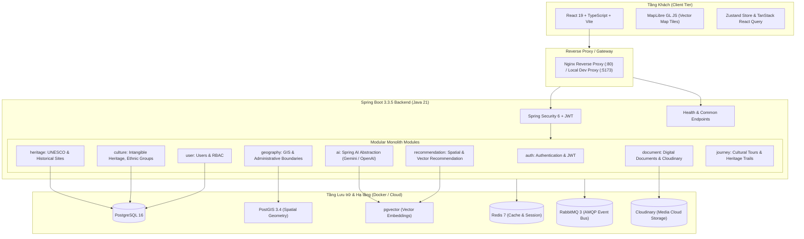

# System Architecture - Vietnam Cultural Atlas

## 1. Tổng quan Kiến trúc

**Vietnam Cultural Atlas** được thiết kế theo mô hình **Modular Monolith** ở tầng Backend nhằm đảm bảo tính đơn giản trong vận hành giai đoạn đầu, sự nhất quán dữ liệu không gian và vector, đồng thời vẫn bảo đảm tính độc lập theo ranh giới nghiệp vụ (domain boundaries).

---

## 2. Phân chia Module & Trách nhiệm (Modular Monolith)

| Module | Package | Trách nhiệm chính |
| :--- | :--- | :--- |
| **Config** | `com.culturalatlas.config` | Bảo mật (SecurityFilterChain, CORS), Swagger/OpenAPI, Redis, Cache |
| **Common** | `com.culturalatlas.common` | `ApiResponse<T>`, `ErrorResponse`, `GlobalExceptionHandler`, Health Check API |
| **Auth** | `com.culturalatlas.auth` | Quản lý đăng ký/đăng nhập, xác thực JWT, mã hóa mật khẩu BCrypt |
| **User** | `com.culturalatlas.user` | Người dùng, phân quyền (ROLE_USER, ROLE_RESEARCHER, ROLE_ADMIN) |
| **Geography** | `com.culturalatlas.geography` | Tọa độ địa lý, polygon ranh giới 63 tỉnh/thành, PostGIS spatial queries |
| **Culture** | `com.culturalatlas.culture` | Lễ hội, ẩm thực địa phương, 54 dân tộc, phong tục tập quán |
| **Heritage** | `com.culturalatlas.heritage` | Di tích lịch sử quốc gia, di sản UNESCO, làng nghề truyền thống |
| **Document** | `com.culturalatlas.document` | Tư liệu lịch sử số hóa, văn bản Hán Nôm/văn hiến, liên kết Cloudinary |
| **AI** | `com.culturalatlas.ai` | Spring AI framework, tích hợp LLM (Gemini/OpenAI), Text Embeddings |
| **Recommendation** | `com.culturalatlas.recommendation` | Gợi ý địa điểm theo vị trí địa lý kết hợp cosine similarity vector |
| **Journey** | `com.culturalatlas.journey` | Lộ trình du lịch văn hóa tương tác (Heritage Trail planner) |

---

## 3. Kiến trúc Dữ liệu & GIS (PostGIS + pgvector)

PostgreSQL đóng vai trò trung tâm lưu trữ đồng nhất cho cả 3 loại dữ liệu:
1. **Dữ liệu quan hệ (Relational)**: Bảng người dùng, thông tin di sản, tài liệu, quan hệ N-N.
2. **Dữ liệu không gian (Spatial/GIS via PostGIS)**: Điểm tọa độ `geometry(Point, 4326)`, ranh giới hành chính `geometry(MultiPolygon, 4326)`, hỗ trợ hàm `ST_DWithin`, `ST_DistanceSphere`.
3. **Dữ liệu Vector (Embeddings via pgvector)**: Cột `vector(768)` hoặc `vector(1536)` cho tóm tắt di sản và tài liệu, hỗ trợ tìm kiếm ngữ nghĩa theo Cosine Distance (`<=>`) hoặc L2 Distance (`<->`).

---

## 4. Frontend Architecture (React 19 + TypeScript + Vite)

- **Vite**: Build tool siêu tốc với HMR.
- **Tailwind CSS v4**: Utility-first styling hiệu năng cao.
- **MapLibre GL JS**: Thư viện render bản đồ vector client-side mã nguồn mở, không phụ thuộc Mapbox API key bản quyền.
- **Zustand**: Quản lý global UI state (tọa độ bản đồ, bộ lọc di sản, trạng thái phiên làm việc).
- **TanStack React Query**: Quản lý server state, tự động cache, retry và đồng bộ API.
- **Axios**: HTTP Client với base URL linh hoạt và request/response interceptors.

